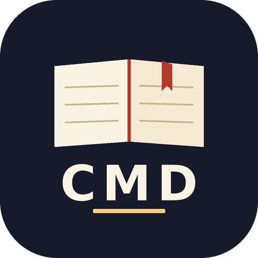

<div align="center">



# CMD Book

**مكتبة كتب وPDF شخصية لأندرويد، بتصميم «ورق وحبر»**

**A personal book and PDF library for Android, in the "Paper & Ink" design (Arabic, RTL)**

[Download / تحميل](https://github.com/moh500600/nidal-books/releases/latest) · [Features](#features--المميزات) · [Privacy](#privacy-and-ai--الخصوصية-والذكاء-الاصطناعي) · [Build](#build-from-source--البناء-من-المصدر)

`v0.1.1` · Android 7.0+ · MIT

</div>

> **Status: version 0.1.1.** It builds and passes the automated analysis and tests on GitHub, but it has not yet been tested on a physical device, and its screens have not yet been compared one by one with the approved design. Expect rough edges. Please report them in Issues.
>
> **الحالة: الإصدار 0.1.1.** يُبنى ويجتاز الفحص والاختبارات الآلية على GitHub، لكنه لم يُجرَّب بعد على جهاز فعلي، ولم تُقارن شاشاته بالتصميم المعتمد شاشة بشاشة. قد تظهر ملاحظات، أبلغ عنها في Issues.

## Download / تحميل

Open the [latest release](https://github.com/moh500600/nidal-books/releases/latest) and pick one file:

| File | Use it on |
|---|---|
| `CMDBook-arm64-v8a.apk` | most modern phones (choose this if unsure) |
| `CMDBook-armeabi-v7a.apk` | older 32-bit phones |

Requires Android 7.0 or newer. Android will ask you to allow installing from unknown sources for your browser or file manager.

The APKs are signed with a CMD Book release key. Certificate SHA-256:

```
0d5d9310c20d63ebe9695632a1c88ddcf577b69b8f003ee6d4153140f275b497
```

You can check it with `apksigner verify --print-certs <file>.apk`.

## Features / المميزات

Implemented in the code; not yet verified on a device.

- **Library / المكتبة:** import PDF and TXT files (several at once, duplicate check), list or grid view, filters and sorting, shelves, categories, edit book details.
- **Reader / القارئ:** text mode with light and dark themes and font size, page slider, in-book search, contents, bookmarks, highlights and notes from selected text, original PDF view, text-to-speech with the device voice.
- **Search / البحث:** across titles, authors and the text inside books.
- **Notes / الملاحظات:** all notes in one place, export as Markdown.
- **Profile / الملف الشخصي:** reading stats, weekly goal, optional PIN lock.
- **Backup / النسخ الاحتياطي:** backup and restore as a JSON file, share a reading list as text.
- **Library management / إدارة المكتبة:** storage use, duplicates, missing files.
- **Nidal AI (optional, online):** chat with a book, page summary, quiz, translation. See below.

Not included: cloud sync across devices, live sharing between users, a server admin dashboard. There is no server in this project.

## Privacy and AI / الخصوصية والذكاء الاصطناعي

- **Storage is local.** Books, notes, shelves and settings are stored on the phone (SQLite, files, app preferences). There is no account and no server of ours.
- **The backup file does not contain your book files.** It holds the library data, shelves and notes. Keep your PDF and TXT files yourself. If they are lost, restoring a backup will not bring them back.
- **Nidal AI is optional and needs internet.** You enter the base URL of an OpenAI-compatible provider, a model name and your own API key in Settings. When you use an AI feature, the app sends your question and text from the book (the open page and the pages around it, up to about 4 pages) directly to that provider, and the provider's own terms apply. Without a key, the AI features do not run.
- **The API key is kept in Android's encrypted secure storage on the phone** (not in plain preferences) and is sent only to the provider you set. The PIN is stored as a salted PBKDF2 hash, never in plain text, with a delay after 5 wrong tries. The PIN lock is an app lock, not file encryption of your books. These changes are covered by unit tests in CI but not yet tested on a device. Version 0.1.0 stored both the key and the PIN as plain text; installing 0.1.1 over it moves them to the safer storage.
- Without a key, only small on-device helpers work (an extractive summary and flashcards from your highlights). They are not a language model.

## Usage / الاستخدام

1. Install the APK and open the app. Create a local profile (PIN is optional).
2. Add books from the Library tab with **Import**.
3. Open a book to read. Select text to highlight or add a note.
4. To use Nidal AI, open its settings and enter a provider URL, model and key.
5. Use Profile → Backup regularly, and keep your book files.

## Build from source / البناء من المصدر

Requirements: Flutter (the project is built in CI with Flutter 3.50.1), JDK 17, Android SDK.

```bash
flutter pub get
flutter analyze
flutter test
flutter build apk --release --split-per-abi
```

The `Build APK` workflow in `.github/workflows/build-apk.yml` does the same on GitHub and uploads the APKs as an artifact. Release builds are signed with a key that is not in this repository. A build you make yourself is signed with your own key or the debug key, so it will not install over an official release.

Layout: `lib/core.dart` (data and services), `lib/ui.dart` (shared widgets and theme), then one file per area (`library.dart`, `reader.dart`, `discover.dart`, `notes.dart`, `account.dart`, `ai.dart`, `onboarding.dart`). Arabic fonts (Noto Kufi, Naskh, Sans) are bundled under `assets/fonts`.

## Contributing / المساهمة

The project is public. You can download, use, modify and share it. Issues and pull requests are welcome. For visual changes, the reference is the "Paper & Ink" design direction.

## License / الرخصة

[MIT](LICENSE). The sample book text is a short public-domain excerpt of Ibn Khaldun's *Muqaddima*.
